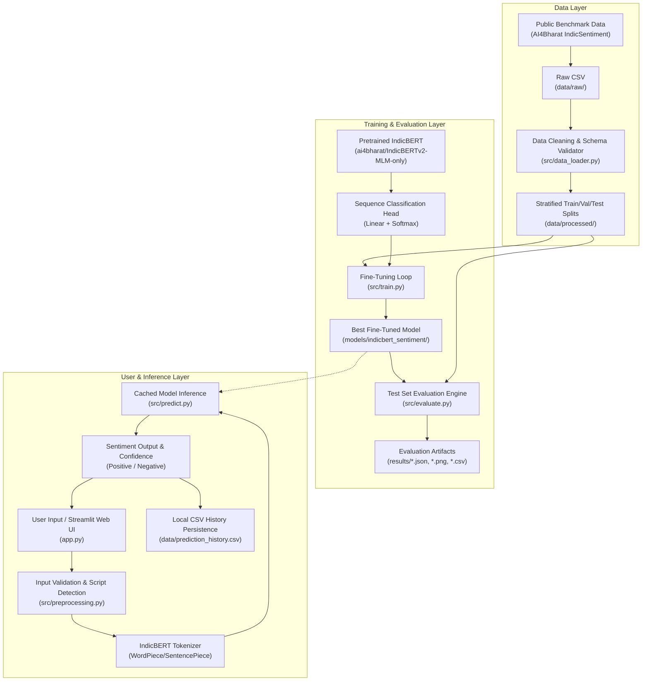

# System Architecture: Low-Resource Indic Text Classifier

This document details the architectural design, software components, and data pipelines of the **IndicBERT Multilingual Text Classifier**.

---

## 1. High-Level Architecture Overview

The system consists of two interconnected pipelines:
1. **The Training & Transfer Learning Pipeline**: Prepares raw multi-script datasets, fine-tunes IndicBERT using stratified splits, evaluates model performance, and produces evaluation artifacts.
2. **The Inference & Web Application Pipeline**: Accepts native Indic text (single or batch CSV), performs script detection, generates sentiment predictions with confidence scores, and persists history locally.

---

## 2. Component Breakdown

### 2.1 Data Processing Pipeline (`src/data_loader.py` & `src/preprocessing.py`)
- **Data Ingestion**: Loads CSV with UTF-8 encoding to preserve multi-byte Indian scripts (Tamil, Devanagari, Malayalam).
- **Schema Validation**: Enforces the presence of `text`, `language`, and `label` columns.
- **Data Cleaning**: Strips HTML tags, trims whitespace, and normalizes labels and language names.
- **Deduplication**: Drops duplicate records and detects conflicting duplicate labels (e.g., identical reviews marked as both positive and negative).
- **Stratified Splitting**: Splits data 70% train, 15% validation, and 15% test using a composite `language_label` stratum to prevent class or language imbalance across splits.

### 2.2 Model & Transfer Learning Architecture (`src/model.py` & `src/train.py`)
- **Backbone**: `ai4bharat/IndicBERTv2-MLM-only`, a 12-layer transformer model pretrained on 23 Indic languages across 250M+ tokens.
- **Classification Head**: A dropout layer ($p=0.1$) followed by a linear transformation layer ($768 \rightarrow 2$) mapping contextual embeddings to positive and negative sentiment logits.
- **Parameter Freezing**: For resource-constrained hardware (e.g. CPU laptops), the base transformer encoder is frozen, training only the classification head and pooler with AdamW ($lr=1e-3$). On GPU, full fine-tuning is supported ($lr=2e-5$).
- **Early Stopping & Checkpointing**: Tracks validation Macro F1 at each epoch and saves the best model state dict.

### 2.3 Evaluation Pipeline (`src/evaluate.py` & `src/metrics.py`)
- **Held-Out Evaluation**: The final model is strictly evaluated on `data/processed/test.csv`, which was never observed during training or validation.
- **Metrics Computed**:
  - Global Accuracy
  - Macro-Averaged Precision, Recall, and F1-Score
  - Per-class precision, recall, and support
  - Multilingual breakdown (performance evaluated independently for Tamil, Hindi, and Malayalam)
  - Confusion Matrix plot generated via Seaborn

### 2.4 Local CSV History Engine (`src/history.py`)
- **Zero Database Requirement**: Replaces external database servers (MySQL, MongoDB, SQLite) with an append-only, UTF-8 encoded local CSV file (`data/prediction_history.csv`).
- **Schema**:
  `timestamp, text, language, predicted_sentiment, confidence, model_identifier`
- **Operations**: Append, read, newest-first sorting, text search, language/sentiment filtering, and CSV export.

### 2.5 Web Application Layer (`app.py`)
- Built using **Streamlit** with a modular multi-page dashboard.
- Utilizes an in-memory singleton pattern to load the fine-tuned model once into memory rather than on every user click.
- Provides interactive visual feedback including probability bar charts, metrics cards, confusion matrix heatmaps, and dataset split explorers.
