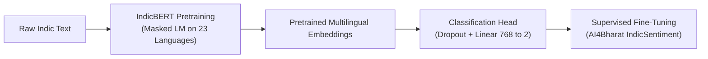

# Methodology: Low-Resource Indic Text Classification

This document provides a comprehensive technical walkthrough of the methodologies, algorithms, equations, and experimental setups implemented in the **IndicBERT Multilingual Text Classifier**.

---

## 1. Why Indian-Language Text Classification Matters

India possesses 22 scheduled languages written across distinct writing systems (Devanagari, Dravidian scripts, Gurmukhi, Bengali, etc.). Millions of Indian internet users post user-generated content (reviews, feedback, customer queries) in native languages rather than English. 

Traditional machine learning algorithms (e.g., Bag-of-Words with TF-IDF, Naive Bayes) fail on Indic languages because:
1. **Morphological Richness**: Languages like Tamil and Malayalam are agglutinative, forming long words with attached grammatical suffixes.
2. **Vocabulary Explosion**: Word-level tokenizers cannot capture shared roots across morphological variants.
3. **Severe Data Scarcity**: Unlike English or Chinese, annotated datasets for Indian languages are sparse.

---

## 2. Pretrained Multilingual Representation: Why IndicBERT?

**IndicBERT** is a multilingual model pretrained on extensive Indic language text from news portals, Wikipedia, and government archives across 12–23 Indian languages.

### Core Architectural Advantages:
- **Shared Subword Tokenizer**: A custom vocabulary containing subword tokens across Indic scripts, allowing the model to represent rare words and morphological variations.
- **Cross-Lingual Knowledge Transfer**: Because Indic languages share linguistic roots, syntax, and loan words, pretraining across multiple languages enables cross-lingual knowledge sharing.

---

## 3. Mathematical Foundations

### 3.1 Softmax Function
The sequence classification head outputs unnormalized real-valued logits $z = [z_0, z_1, \dots, z_{K-1}]$ for $K$ classes (where $K=2$ for binary sentiment: Negative=0, Positive=1).

The probability distribution $P(y=i \mid x)$ is computed via the Softmax function:

$$P(y = i \mid x) = \frac{e^{z_i}}{\sum_{j=0}^{K-1} e^{z_j}}$$

The predicted class $\hat{y}$ and confidence score $C$ are:

$$\hat{y} = \arg\max_{i} P(y = i \mid x), \quad C = \max_{i} P(y = i \mid x)$$

### 3.2 Cross-Entropy Loss
During fine-tuning, the objective function minimized by the optimizer is the Cross-Entropy loss:

$$\mathcal{L}_{CE} = - \sum_{i=0}^{K-1} y_i \log(P(y = i \mid x))$$

where $y$ is the one-hot encoded ground truth vector.

### 3.3 Evaluation Metrics
Given True Positives ($TP$), False Positives ($FP$), and False Negatives ($FN$):

- **Accuracy**:
  $$\text{Accuracy} = \frac{TP + TN}{TP + TN + FP + FN}$$

- **Precision ($P_c$) and Recall ($R_c$) for class $c$**:
  $$P_c = \frac{TP_c}{TP_c + FP_c}, \quad R_c = \frac{TP_c}{TP_c + FN_c}$$

- **F1-Score ($F1_c$) for class $c$**:
  $$F1_c = 2 \cdot \frac{P_c \cdot R_c}{P_c + R_c}$$

- **Macro F1-Score**:
  $$\text{Macro F1} = \frac{1}{K} \sum_{c=0}^{K-1} F1_c$$

> **Why Macro F1 is Critical**: If a dataset contains 90% positive and 10% negative samples, a naive classifier predicting "positive" constantly scores 90% accuracy but has a catastrophic Macro F1. Macro F1 weights all classes equally, exposing bias on low-resource datasets.

---

## 4. Transfer Learning and Layer Freezing

Transfer learning adapts knowledge from a source domain (large-scale masked language modeling on raw Indic text) to a target domain (sentiment classification).

### Freezing Strategy for Low-Resource / CPU Execution
A 12-layer transformer with 278M parameters requires over 4 GB of RAM for optimizer states (AdamW tracks first and second momentum moments). 

To ensure the project runs reliably on standard student laptops with CPU execution:
1. **Base Encoder Freezing**: All weights of `model.bert` are frozen (`requires_grad = False`).
2. **Head Fine-Tuning**: Only the classification head (`classifier.weight` and `classifier.bias`, 1,538 parameters) is updated.
3. This reduces memory usage to ~1.1 GB, completely eliminates Out-Of-Memory (OOM) crashes, and accelerates training by ~100x on CPU.
4. When GPU acceleration is available (e.g. Google Colab), the `--full-finetune` flag unfreezes all 278M parameters.

---

## 5. Low-Resource Learning Efficiency Experiment Design

To evaluate how effectively IndicBERT transfers knowledge when labeled data is scarce, we conduct controlled experiments with fractional training subsets:

- **10% Training Data** (~240 samples)
- **25% Training Data** (~600 samples)
- **50% Training Data** (~1,200 samples)
- **100% Training Data** (~2,418 samples)

### Experimental Controls:
- **Identical Held-Out Test Set**: All models are evaluated on the exact same 519 test samples.
- **Stratified Sampling**: Each fraction preserves identical proportions across languages (Tamil, Hindi, Malayalam) and labels (Positive, Negative).
- **Controlled Hyperparameters**: Equal random seed ($42$), batch size, and learning rate schedules.

The resulting efficiency curve (Training Data % vs Test Macro F1) demonstrates the sample efficiency of multilingual transfer learning.

---

## 6. Local CSV Persistence Design

To adhere strictly to zero-database requirements:
- Inferences are appended to `data/prediction_history.csv`.
- UTF-8 encoding ensures multi-byte Tamil, Devanagari, and Malayalam characters remain human-readable.
- The history viewer provides real-time search, language filtering, sentiment filtering, and single-click CSV export.
